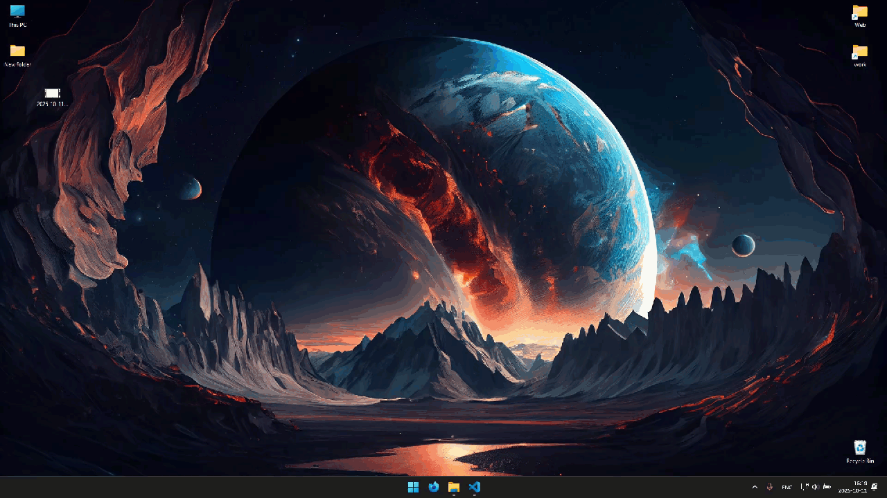
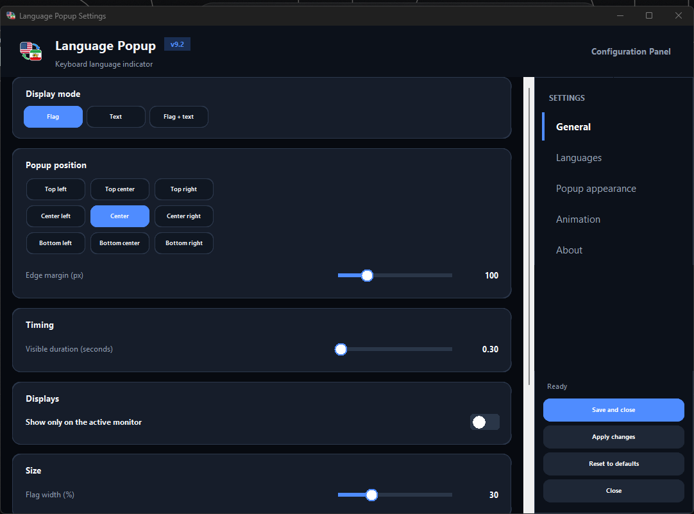
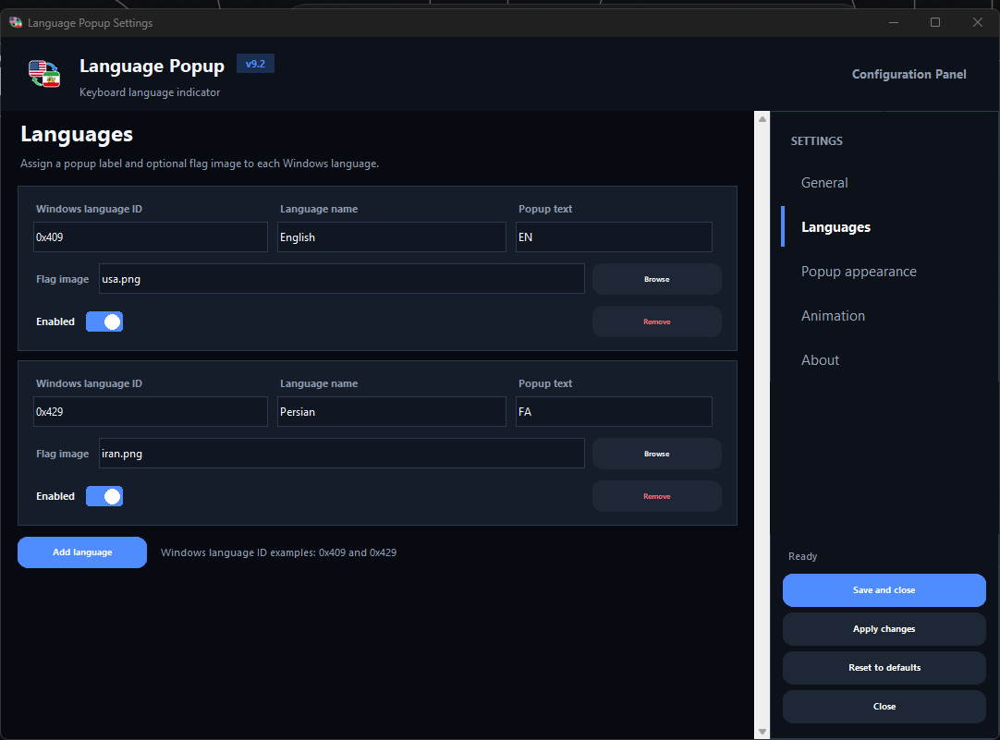
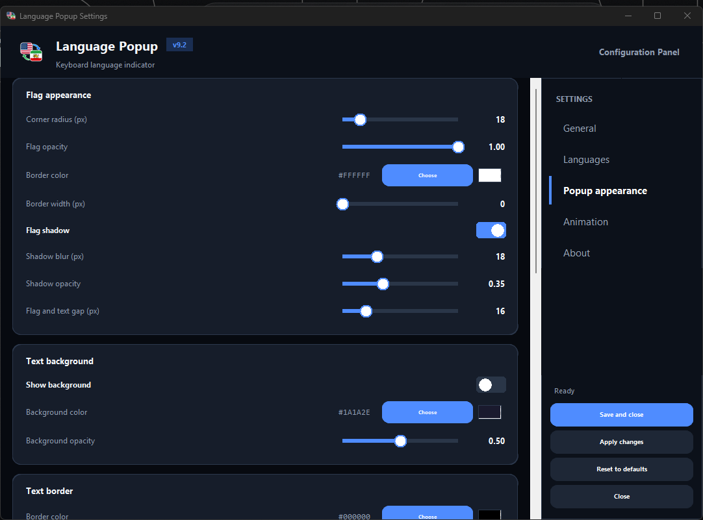
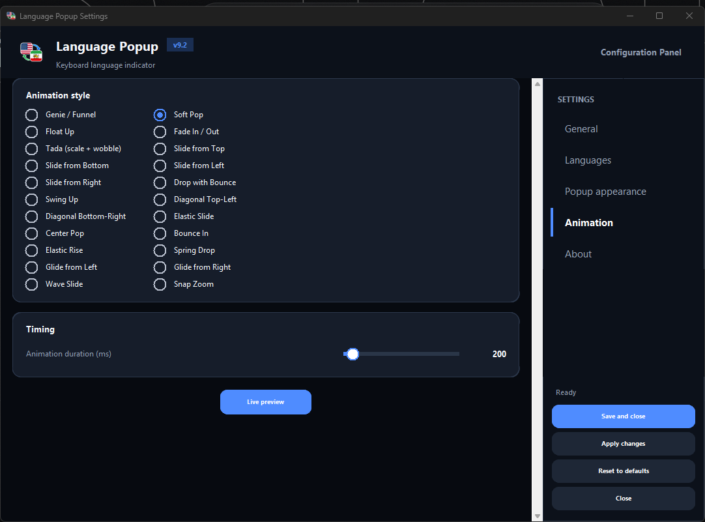
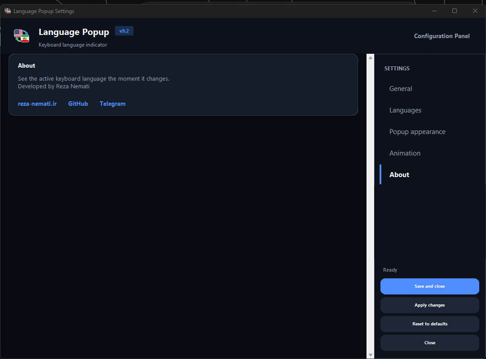

# Language Flag Pop-Up (v9.2 Pro Vanguard)

ابزار حرفه‌ای، سبک و گرافیکی ویندوز برای نمایش لحظه‌ای زبان فعال کیبورد به شکل پرچم، متن دلخواه یا ترکیب هر دو با انیمیشن‌های سینمایی و رابط کاربری بازطراحی‌شده.



## 🖼️ اسکرین‌شات‌ها

| عمومی | زبان‌ها |
| --- | --- |
|  |  |

| ظاهر پاپ‌آپ | انیمیشن |
| --- | --- |
|  |  |

| درباره |
| --- |
|  |

## ✨ قابلیت‌ها و ویژگی‌های نسخه 9.2

- **رابط کاربری گرافیکی و حرفه‌ای (Vanguard / Linear-grade)**: بازطراحی کامل پنل تنظیمات با تم‌های تیره/روشن فوق‌العاده شیک، پالت رنگی مدرن، کارت‌های دو‌لایه، دکمه‌های حبابی و المان‌های بصری مینیمال.
- **مدیریت پیشرفته زبان‌ها**: افزودن و ویرایش نامحدود زبان‌ها با استفاده از Windows Language ID، نام سفارشی، متن نمایشی و فایل پرچم مستقل (PNG, WEBP, JPG).
- **سه حالت نمایش منحصربه‌فرد**:
  - حالت **پرچم (Flag)** با گوشه‌های گرد قابل تنظیم و سایه نرم.
  - حالت **متن (Text)** با قابلیت سفارشی‌سازی فونت، سایه، ضخامت، حاشیه و افکت Glow.
  - حالت **پرچم و متن (Flag + Text)** برای نمایش هم‌زمان پرچم و شناسه زبان.
- **22 انیمیشن روان و چشم‌نواز**: شامل Genie / Funnel (افکت خفن جینی)، Soft Pop، Float Up، Tada، Drop Bounce، Elastic Slide و سایر حرکات فیزیکی نرم.
- **انتخاب موقعیت و مانیتور**: قرارگیری در یکی از 9 موقعیت صفحه با تنظیم حاشیه لبه، و پشتیبانی کامل از مانیتورهای چندگانه یا فقط مانیتور فعال.
- **پیش‌نمایش زنده (Live Preview)**: تست آنی انیمیشن و ظاهر پرچم پیش از ذخیره نهایی.
- **پشتیبانی بی‌نقص از DPI**: هماهنگی کامل با مانیتورهای با رزولوشن بالا (4K/Retina) و مقیاس‌گذاری ویندوز.
- **بهینه‌سازی عملکرد**: کش فونت و تصویر پرچم (بدون دیکد مجدد در هر نمایش)، صف سبک‌تر و مصرف CPU کمتر در پس‌زمینه.
- **اجرای تک‌نمونه**: جلوگیری از اجرای هم‌زمان چند نسخه از برنامه با Mutex ویندوز.
- **System Tray اختصاصی**: دسترسی سریع به تنظیمات و خروج از طریق منوی System Tray.

---

## 🚀 راه‌اندازی و توسعه

پایتون ۳.۹ یا جدیدتر توصیه می‌شود.

```powershell
# نصب وابستگی‌ها
python -m pip install -r requirements.txt

# اجرای مستقیم پنل تنظیمات
python language_flag_popup.pyw --settings

# اجرای عادی برنامه در پس‌زمینه
python language_flag_popup.pyw
```

---

## 🌐 جدول زبان‌ها و تنظیمات

| مقدار | توضیح | مثال |
| --- | --- | --- |
| **Windows ID** | شناسه استاندارد زبان در ویندوز | `0x409` (انگلیسی)، `0x429` (فارسی) |
| **Name** | نام نمایشی در تنظیمات | `English`، `Persian` |
| **Popup text** | متن کوتاه‌تر برای حالت متنی | `EN`، `FA` |
| **Flag image** | تصویر پرچم (مسیر نسبی یا مطلق) | `iran.png`، `usa.png` |

---

## 📦 ساخت فایل اجرایی (EXE) و Installer

برای ساخت فایل EXE مستقل با استفاده از PyInstaller:

```powershell
pyinstaller --clean language_flag_popup.spec
```
فایل نهایی در پوشه `dist/language_flag_popup.exe` قرار می‌گیرد.

برای ساخت نصب‌کننده (Installer) حرفه‌ای، اسکریپت `installer_script.iss` را با نرم‌افزار **Inno Setup** کامپایل کنید تا فایل `LanguageFlagPopUp_Setup.exe` ساخته شود (با قابلیت اجرای خودکار همراه با راه‌اندازی ویندوز).

---

## 📂 مسیر ذخیره تنظیمات

در حالت سورس، تنظیمات در فایل `settings.json` ذخیره می‌شوند. در نسخه نصب‌شده یا EXE، تنظیمات در پوشه AppData قرار دارند:
```text
%LOCALAPPDATA%\LanguagePopup\settings.json
```

---

## 📄 مجوز (License)

این پروژه تحت [MIT License](LICENSE) منتشر شده است.

توسعه‌داده‌شده توسط **Reza Nemati** · 🌐 [reza-nemati.ir](https://reza-nemati.ir)
